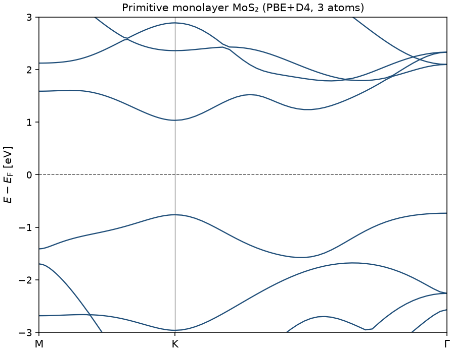

# DFT Band Structure

A Kohn-Sham band structure plots the one-electron eigenvalues $\varepsilon_{n\mathbf{k}}$ along a
path of high-symmetry $\mathbf{k}$-points in the Brillouin zone. Together with
[DOS and PDOS](../dos), it is used to answer questions such as:

- Is the material metallic, semiconducting, or insulating, and is the band gap direct or indirect?
- Where in the Brillouin zone are the valence-band maximum (VBM) and conduction-band minimum (CBM)
  located?
- How dispersive are the frontier bands, and how large are the carrier effective masses?
- How do strain, spin polarization, or structural changes shift band edges and split degeneracies?

In CP2K, a band-structure calculation is a non-self-consistent post-SCF step: CP2K first converges
the ground-state density on the SCF sampling mesh (or at the $\Gamma$ point), then builds and
diagonalizes the Kohn-Sham Hamiltonian along the requested $\mathbf{k}$-point path.

## Basic CP2K input

Band-structure output is controlled by
[&DFT%PRINT%BAND_STRUCTURE](#CP2K_INPUT.FORCE_EVAL.DFT.PRINT.BAND_STRUCTURE). Define one or more
[&KPOINT_SET](#CP2K_INPUT.FORCE_EVAL.DFT.PRINT.BAND_STRUCTURE.KPOINT_SET) subsections to specify the
high-symmetry path:

```text
&FORCE_EVAL
  &DFT
    &KPOINTS
      SCHEME MONKHORST-PACK 15 15 1
      GAMMA_CENTERED
    &END KPOINTS
    &SCF
      ADDED_MOS 8
      &SMEAR
        METHOD FERMI_DIRAC
        ELECTRONIC_TEMPERATURE 300
      &END SMEAR
    &END SCF
    &PRINT
      &BAND_STRUCTURE
        FILE_NAME moS2_prim.bs
        ADDED_MOS 12
        &KPOINT_SET
          UNITS B_VECTOR
          NPOINTS 40
          SPECIAL_POINT M      0.5 0.0 0.0
          SPECIAL_POINT K      0.33333333 0.33333333 0.0
          SPECIAL_POINT GAMMA  0.0 0.0 0.0
        &END KPOINT_SET
      &END BAND_STRUCTURE
    &END PRINT
  &END DFT
&END FORCE_EVAL
```

Useful input keywords are documented in the input reference:

- [FILE_NAME](#CP2K_INPUT.FORCE_EVAL.DFT.PRINT.BAND_STRUCTURE.FILE_NAME): write the band-structure
  data to a dedicated `.bs` file instead of the main CP2K output.
- [ADDED_MOS](#CP2K_INPUT.FORCE_EVAL.DFT.PRINT.BAND_STRUCTURE.ADDED_MOS): number of additional
  unoccupied bands computed during the band-structure step.
- [&KPOINT_SET](#CP2K_INPUT.FORCE_EVAL.DFT.PRINT.BAND_STRUCTURE.KPOINT_SET): define one continuous
  piecewise-linear $\mathbf{k}$-point path. Repeat the subsection for disconnected path segments.
- [UNITS](#CP2K_INPUT.FORCE_EVAL.DFT.PRINT.BAND_STRUCTURE.KPOINT_SET.UNITS): coordinate convention
  for `SPECIAL_POINT` (`B_VECTOR` in fractions of the reciprocal lattice vectors, or `CART_ANGSTROM`
  / `CART_BOHR` in units of $2\pi/\mathrm{\AA}$ or $2\pi/\mathrm{Bohr}$).
- [NPOINTS](#CP2K_INPUT.FORCE_EVAL.DFT.PRINT.BAND_STRUCTURE.KPOINT_SET.NPOINTS): number of segments
  between each consecutive pair of `SPECIAL_POINT` entries (a path with 3 special points and
  `NPOINTS 40` has $2 \times 40 + 1 = 81$ $\mathbf{k}$-points).
- [SPECIAL_POINT](#CP2K_INPUT.FORCE_EVAL.DFT.PRINT.BAND_STRUCTURE.KPOINT_SET.SPECIAL_POINT): name
  and coordinates of each high-symmetry point along the line.

```{note}
`&BAND_STRUCTURE%ADDED_MOS` adds to the number of MOs already present in the SCF calculation
(including any [&SCF%ADDED_MOS](#CP2K_INPUT.FORCE_EVAL.DFT.SCF.ADDED_MOS)). Setting `ADDED_MOS -1`
computes all basis functions, which is rarely necessary for frontier-band plots and increases file
size.
```

## Practical setup

### SCF sampling vs. band path

The SCF integration mesh in [&DFT%KPOINTS](#CP2K_INPUT.FORCE_EVAL.DFT.KPOINTS) determines the
converged electron density and Hamiltonian, whereas `&BAND_STRUCTURE` only evaluates eigenvalues on
the plotting path. Always converge the SCF mesh first; see [k-points](../../dft/k-points).

`&BAND_STRUCTURE` also works after a $\Gamma$-only SCF (omitting `&DFT%KPOINTS`), including OT runs:
CP2K constructs a real-space k-point environment from the converged $\Gamma$-only density before
evaluating the band path. This is appropriate when the simulation cell is large enough that
real-space Hamiltonian and overlap images are well captured within the cell; for small unit cells,
run a proper `&KPOINTS` SCF instead.

### Discontinuous paths and memory control

To plot a path with a jump between non-adjacent high-symmetry points (for example $\Gamma\to X$
followed by $U\to K$), use two separate `&KPOINT_SET` subsections under `&BAND_STRUCTURE`.

For dense paths or large cells, CP2K automatically splits the path into memory-bounded
$\mathbf{k}$-point batches and selects a k-point parallel group size that fits within the per-rank
working-set budget. If you need finer control over MPI distribution, set
[&DFT%KPOINTS%PARALLEL_GROUP_SIZE](#CP2K_INPUT.FORCE_EVAL.DFT.KPOINTS.PARALLEL_GROUP_SIZE); CP2K
treats an explicit value as a minimum group size during band-structure evaluation.

## Output format and plotting

Each `KPOINT_SET` in the `.bs` file starts with a summary header listing the special points,
followed by one block per $\mathbf{k}$-point (and per spin channel for `UKS` calculations):

```text
# Set 1: 3 special points, 81 k-points, 33 bands
#  Special point 1          0.50000000     0.00000000     0.00000000  M
#  Special point 2          0.33333333     0.33333333     0.00000000  K
#  Special point 3          0.00000000     0.00000000     0.00000000  GAMMA
#  Point 1      Spin 1:     0.50000000     0.00000000     0.00000000       0.01234568
#   Band    Energy [eV]     Occupation
       1   -68.19550930     2.00000000
       2   -41.42062602     2.00000000
```

Eigenvalues are written in eV on the absolute Kohn-Sham energy scale. When comparing bands with DOS
or across structures, align the energy zero consistently (for example to the SCF `Fermi energy:` for
metals or to the VBM for semiconductors and insulators).

### Plotting with `tools/band_structure/plot_band_structure.py`

CP2K provides a plotting and CSV-export script under `tools/band_structure/plot_band_structure.py`
(requires `numpy` and `matplotlib`; CSV export requires only `numpy`). Pass `--cp2k-out` so the
script can read both the SCF Fermi energy and the cell vectors needed to scale the horizontal
$\mathbf{k}$-path axis in $\mathrm{\AA}^{-1}$:

```bash
./tools/band_structure/plot_band_structure.py moS2_prim.bs \
  --cp2k-out moS2_prim.out \
  --emin -3 --emax 3 \
  -o mos2_primitive_bands.png
```

To export a flat table for plotting in external tools (such as gnuplot or Origin), add `--csv`:

```bash
./tools/band_structure/plot_band_structure.py moS2_prim.bs \
  --cp2k-out moS2_prim.out --csv moS2_prim.csv
```

{align=center width=460px}

**Figure 1.** PBE band structure of primitive monolayer $\mathrm{MoS}_2$ (3 atoms) along
$M\to K\to\Gamma$, plotted with `plot_band_structure.py`.

```{caution}
CP2K opens `FILE_NAME` in append mode. If you rerun a band-structure calculation in the same
directory without removing the existing `.bs` file, the new output is appended to the old file.
Remove stale `.bs` files before rerunning.
```

## Related pages

- For supercell calculations with defects, dopants, or interfaces where bands fold into a smaller
  Brillouin zone, see [Band Structure Unfolding](unfolding).
- For quasiparticle band structures beyond Kohn-Sham DFT, see [Band structure from *GW*](gw).
