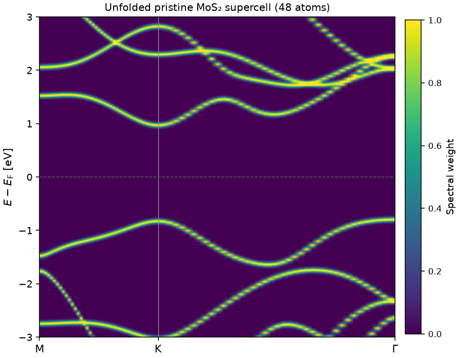
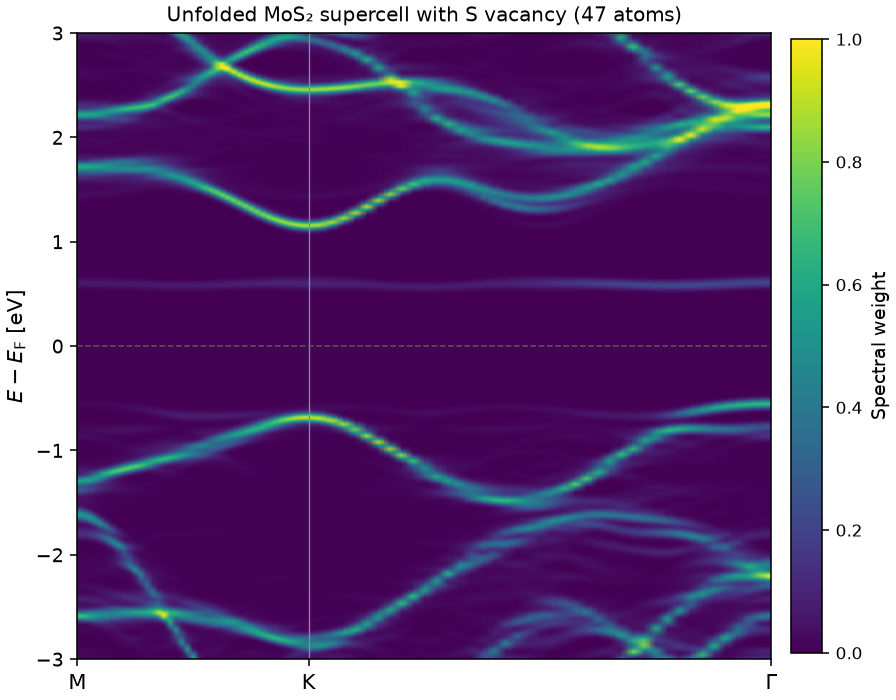
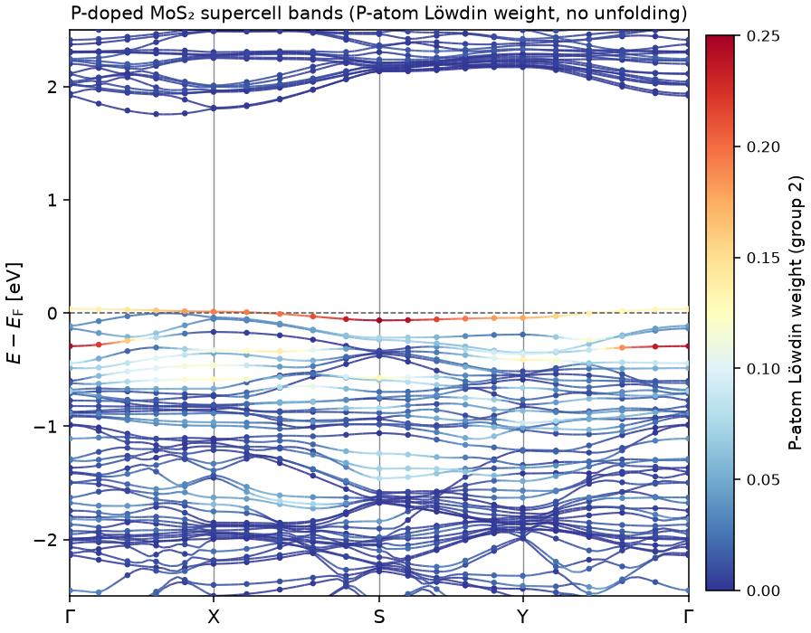
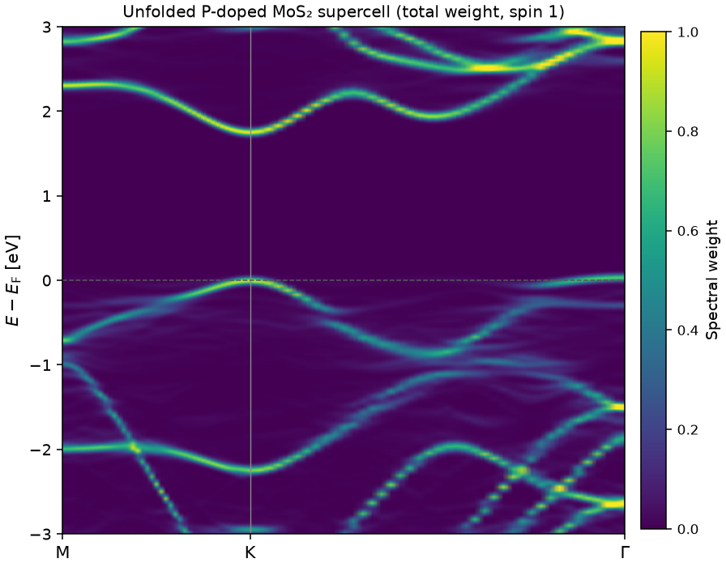
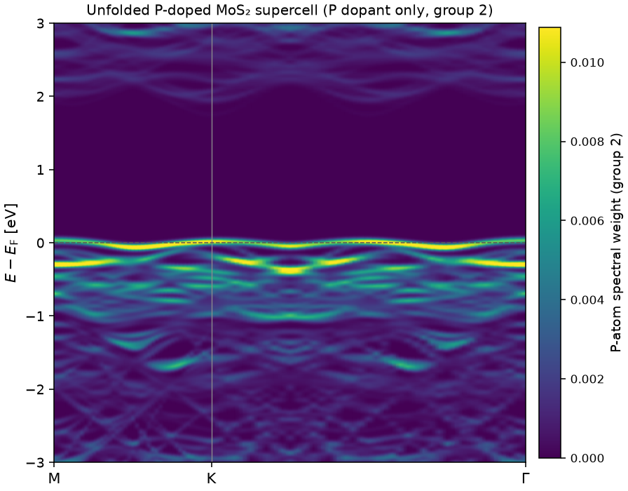

# Band Structure Unfolding

Modeling point defects, dopants, vacancies, alloys, adsorbates, or heterostructures requires
supercells that are much larger than the underlying primitive crystal cell. In reciprocal space, a
supercell with volume ratio $m$ folds the primitive Brillouin zone $m$ times into a smaller
supercell Brillouin zone, turning simple band dispersions into a dense tangle of folded branches.

Band structure unfolding projects supercell Kohn-Sham states back onto a primitive-cell
$\mathbf{k}$-point path to recover an effective band structure (EBS). In practice, it is used to
answer questions such as:

- How much of the pristine host dispersion survives around a vacancy, dopant, or surface
  reconstruction?
- Which features near the band edges or inside the gap are localized defect or impurity states (low,
  broadly distributed spectral weight) versus perturbed host bands (high weight along primitive
  dispersions)?
- How do chemical doping, strain, or spin polarization shift band edges and split acceptor/donor
  states relative to the primitive band structure?
- In a heterostructure or slab-adsorbate system, which bands belong to each layer or atomic
  sub-region?

```{important}
Band structure unfolding under `&DFT%PRINT%BAND_STRUCTURE%UNFOLDING` is available in CP2K 2027.1
and later versions. It reuses the converged SCF density from either a `&KPOINTS` calculation or a
$\Gamma$-only calculation (including OT).
```

## Basic CP2K input

Unfolding is enabled by adding
[&UNFOLDING](#CP2K_INPUT.FORCE_EVAL.DFT.PRINT.BAND_STRUCTURE.UNFOLDING) inside
[&DFT%PRINT%BAND_STRUCTURE](#CP2K_INPUT.FORCE_EVAL.DFT.PRINT.BAND_STRUCTURE). The example below
unfolds a 48-atom orthorhombic $\mathrm{MoS}_2$ supercell ($m = 16$) onto the primitive hexagonal
path $M\to K\to\Gamma$:

```text
&FORCE_EVAL
  &DFT
    &KPOINTS
      SCHEME MONKHORST-PACK 5 5 1
      GAMMA_CENTERED
    &END KPOINTS
    &PRINT
      &BAND_STRUCTURE
        FILE_NAME moS2_perf.bs
        ADDED_MOS 64
        &KPOINT_SET
          UNITS B_VECTOR
          NPOINTS 40
          SPECIAL_POINT M      0.5 0.0 0.0
          SPECIAL_POINT K      0.33333333 0.33333333 0.0
          SPECIAL_POINT GAMMA  0.0 0.0 0.0
        &END KPOINT_SET
        &UNFOLDING
          TRANSFORMATION_MATRIX 4 2 0 0 4 0 0 0 1
          SYMM_TOL 0.5
        &END UNFOLDING
      &END BAND_STRUCTURE
    &END PRINT
  &END DFT
&END FORCE_EVAL
```

The unfolding subsection exposes three keywords:

- [TRANSFORMATION_MATRIX](#CP2K_INPUT.FORCE_EVAL.DFT.PRINT.BAND_STRUCTURE.UNFOLDING.TRANSFORMATION_MATRIX):
  nine integers (entered row by row) defining the $3\times 3$ matrix $\mathbf{M}$ that relates the
  supercell lattice vectors to the target primitive cell.
- [ATOMS](#CP2K_INPUT.FORCE_EVAL.DFT.PRINT.BAND_STRUCTURE.UNFOLDING.ATOMS): optional repeatable
  atom-index lists selecting which atoms contribute to the unfolding weights (or splitting the
  weights into per-group columns).
- [SYMM_TOL](#CP2K_INPUT.FORCE_EVAL.DFT.PRINT.BAND_STRUCTURE.UNFOLDING.SYMM_TOL): Cartesian
  tolerance (in $\mathrm{\AA}$, default `0.5`) used to group supercell atoms that are primitive
  lattice images of the same site.

```{note}
When `&UNFOLDING` is active, every
[SPECIAL_POINT](#CP2K_INPUT.FORCE_EVAL.DFT.PRINT.BAND_STRUCTURE.KPOINT_SET.SPECIAL_POINT) in
`&KPOINT_SET` must be given in **primitive-cell** coordinates (not supercell coordinates). If
`UNITS CART_ANGSTROM` or `CART_BOHR` is used, CP2K converts the Cartesian coordinates with the
primitive lattice to avoid double folding.
```

## Setting up and verifying a calculation

### Choosing and checking `TRANSFORMATION_MATRIX`

CP2K uses the **column-vector** convention (matching VESTA and Phonopy, and the transpose of the
row-vector convention used by ASE and pymatgen):

$$
[\mathbf{A}_1\ \mathbf{A}_2\ \mathbf{A}_3] = [\mathbf{a}_1\ \mathbf{a}_2\ \mathbf{a}_3]\,\mathbf{M},
\qquad
\mathbf{A}_j = \sum_{i=1}^{3} M_{ij}\,\mathbf{a}_i,
$$

where $\mathbf{A}_1, \mathbf{A}_2, \mathbf{A}_3$ are the supercell vectors in
[&CELL](#CP2K_INPUT.FORCE_EVAL.SUBSYS.CELL) (after `MULTIPLE_UNIT_CELL`, if used) and
$\mathbf{a}_1, \mathbf{a}_2, \mathbf{a}_3$ are the target primitive vectors. For example, an
orthorhombic $\mathrm{MoS}_2$ supercell with $\mathbf{A}_1 = 4\mathbf{a}_1$,
$\mathbf{A}_2 = 2\mathbf{a}_1 + 4\mathbf{a}_2$, and $\mathbf{A}_3 = \mathbf{a}_3$ corresponds to

$$
\mathbf{M} =
\begin{bmatrix}
  4 & 2 & 0 \\
  0 & 4 & 0 \\
  0 & 0 & 1
\end{bmatrix},
\qquad
m = |\det\mathbf{M}| = 16,
$$

entered row by row as `TRANSFORMATION_MATRIX 4 2 0 0 4 0 0 0 1`.

Always verify your matrix in the `UNFOLD_BAND|` summary printed in the CP2K output before trusting a
plot:

```text
 UNFOLD_BAND| M (rows) =   4   2   0   0   4   0   0   0   1
 UNFOLD_BAND| m = |det M| = 16 ; site tolerance [angstrom] =   0.5000
 UNFOLD_BAND| primitive cell vector 1 [Bohr] =    5.961596    0.000000    0.000000
 UNFOLD_BAND| primitive cell vector 2 [Bohr] =   -2.980798    5.162894    0.000000
 UNFOLD_BAND| primitive cell vector 3 [Bohr] =    0.000000    0.000000   34.015070
 UNFOLD_BAND| equivalent-site sets: 3 (52 AO channels); incomplete sets (vacancies): 0
 UNFOLD_BAND| max assignment residual [angstrom] =     0.000000
 UNFOLD_BAND| Set 1: 81 path points -> 78 unique supercell K-points
 UNFOLD_BAND| Set check max|sum_q W - Loewdin population| =  4.00E-15
```

Check four items in this summary:

1. **Primitive cell vectors**: confirm their lengths and angles match your intended primitive cell
   (if $\mathbf{M}$ was accidentally transposed, these vectors will be wrong).
1. **Incomplete sets**: must be `0` for an ideal supercell; a single vacancy leaves `1` incomplete
   set; a single substitutional dopant leaves `2` (one host site missing an atom plus the single
   dopant atom).
1. **Max assignment residual**: tracks atomic relaxation away from ideal primitive lattice sites.
1. **Sum-rule check**: `max|sum_q W - Loewdin population|` should be near machine precision
   ($\sim 10^{-14}$–$10^{-15}$).

### Handling relaxations, vacancies, and dopants with `SYMM_TOL`

CP2K matches equivalent supercell atoms by element (with `GHOST` kinds treated as their base
element) and requires equivalent atoms to share the same basis set. The default `SYMM_TOL 0.5`
($\mathrm{\AA}$) accommodates typical DFT relaxations around point defects.

- If strong relaxations split equivalent atoms into unexpected incomplete sets (leaving residual
  uncancelled folded branches), increase `SYMM_TOL`.
- If closely spaced inequivalent sites trigger an assignment-conflict abort, decrease `SYMM_TOL` or
  separate the sublattices using multiple `ATOMS` groups.

### Selecting regions and layer-resolved weights with `ATOMS`

The repeatable [ATOMS](#CP2K_INPUT.FORCE_EVAL.DFT.PRINT.BAND_STRUCTURE.UNFOLDING.ATOMS) keyword
controls both spatial screening and group decomposition:

- **Omitted**: all atoms are unfolded together as one group (4 columns in `.bs`).
- **Given once** (for example `ATOMS 1..75`): only the listed atoms contribute to the weights;
  unlisted atoms (such as an incommensurate substrate or an adsorbate) are screened out.
- **Given $G \ge 2$ times**: each group is unfolded independently. Column 4 holds the combined
  weight and columns $5 \dots 4+G$ hold `W_grp1 ... W_grpG` (for example, top vs. bottom layer in a
  heterostructure).
- **Special case $\mathbf{M} = \mathbf{I}$**: omitting `TRANSFORMATION_MATRIX` (default identity)
  with multiple `ATOMS` lines produces Löwdin-projected fat bands per atom group without folding.

### Unoccupied bands and memory for large supercells

As in standard [DFT band structures](dft),
[&BAND_STRUCTURE%ADDED_MOS](#CP2K_INPUT.FORCE_EVAL.DFT.PRINT.BAND_STRUCTURE.ADDED_MOS) adds to the
SCF MO count. Because an $m$-fold supercell has $m$ times as many bands per energy interval as the
primitive cell, increase `ADDED_MOS` roughly in proportion to $m$ to cover the desired conduction
window (for example, `ADDED_MOS 64` for a 48-atom $m = 16$ $\mathrm{MoS}_2$ supercell covers more
than 3 eV above the Fermi level).

For large supercells and dense paths, CP2K automatically batches the unique folded supercell
$\mathbf{K}$-points and increases the k-point parallel group size to stay within its per-rank memory
budget. An explicit
[&DFT%KPOINTS%PARALLEL_GROUP_SIZE](#CP2K_INPUT.FORCE_EVAL.DFT.KPOINTS.PARALLEL_GROUP_SIZE) acts as a
lower bound on the group size used during unfolding.

## What CP2K computes

Each primitive path point $\mathbf{k}$ folds onto a unique supercell $\mathbf{K}$-point via

$$
\mathbf{K} = \mathbf{M}^\mathsf{T}\mathbf{k} \pmod{1}.
$$

CP2K deduplicates the folded $\mathbf{K}$-points before diagonalization so multiple primitive path
points sharing the same $\mathbf{K}$ are diagonalized only once.

To obtain positive, basis-orthogonalized unfolding weights in the atomic-orbital basis (using the
same Löwdin transformation as [PDOS](../dos.md#projection-used-for-pdos)), CP2K forms
$\widetilde{\mathbf{C}}(\mathbf{K}) = \mathbf{S}(\mathbf{K})^{1/2}\mathbf{C}(\mathbf{K})$ at each
supercell $\mathbf{K}$-point and computes the spectral weight of supercell band $N$ at primitive
wavevector $\mathbf{k}_{\mathbf{q}}$ by coherent Bloch-phase summation over each set of equivalent
primitive-cell orbital channels \[[](#Quan2026)\]:

$$
W_{\mathbf{K}N}(\mathbf{k}_{\mathbf{q}})
= \frac{1}{m} \sum_{\alpha}
  \left|
    \sum_{\mu \in \alpha} e^{-i 2\pi \mathbf{k}_{\mathbf{q}}\cdot \mathbf{n}_\mu}\,
    \widetilde{C}_{\mu N}(\mathbf{K})
  \right|^2,
\qquad
\sum_{\mathbf{q}=1}^{m} W_{\mathbf{K}N}(\mathbf{k}_{\mathbf{q}})
= \sum_{\mu \in \text{sel}} \left|\widetilde{C}_{\mu N}(\mathbf{K})\right|^2,
$$

where $\mathbf{n}_\mu$ is the integer primitive-cell lattice offset of AO $\mu$ within its
equivalent-site set $\alpha$. This construction guarantees $W \ge 0$, independence of atom ordering,
and exact satisfaction of the generalized subspace sum rule even when vacancies or `ATOMS` screening
are present (reducing to $\sum_{\mathbf{q}} W_{\mathbf{K}N}(\mathbf{k}_{\mathbf{q}}) = 1$ when all
atoms are selected).

## Output format and plotting

The `.bs` file begins with `UNFOLD_BAND|` metadata (including the primitive cell vectors in Bohr),
followed by the standard `KPOINT_SET` header and per-point band tables with `Unfold_Weight` in
column 4 (and optional `W_grp1 W_grp2 ...` columns when two or more `ATOMS` groups are specified):

```text
# UNFOLD_BAND| M (rows) =   4   2   0   0   4   0   0   0   1
# UNFOLD_BAND| m = |det M| = 16 ; site tolerance [angstrom] =   0.5000
# UNFOLD_BAND| primitive cell vector 1 [Bohr] =    5.96159618    0.00000000    0.00000000
# UNFOLD_BAND| primitive cell vector 2 [Bohr] =   -2.98079809    5.16289374    0.00000000
# UNFOLD_BAND| primitive cell vector 3 [Bohr] =    0.00000000    0.00000000   34.01507039
# UNFOLD_BAND| equivalent-site sets: 3; incomplete sets: 0
# UNFOLD_BAND| atom groups: 1 ; screened atoms: 0
# Set 1: 3 special points, 81 k-points, 280 bands
#  Special point 1          0.50000000     0.00000000     0.00000000  M
#  Special point 2          0.33333333     0.33333333     0.00000000  K
#  Special point 3          0.00000000     0.00000000     0.00000000  GAMMA
# UNFOLD_BAND| path point 1 -> SC K #1 :     0.00000000     0.00000000     0.00000000
#  Point 1      Spin 1:     0.50000000     0.00000000     0.00000000       0.01234568
#   Band    Energy [eV]     Occupation   Unfold_Weight
       1   -68.23384237     2.00000000     0.00000000
      ...
```

### Plotting with `tools/band_structure/plot_band_structure.py`

Use `tools/band_structure/plot_band_structure.py` to plot unfolded or atom-projected band structures
as a Gaussian-broadened spectral map (`--mode spectrum`, default) or as colored band lines with
sparse k-point markers (`--mode lines`). The script reads the primitive cell vectors directly from
the `.bs` header so the horizontal $\mathbf{k}$-path axis is scaled in $\mathrm{\AA}^{-1}$
automatically, and supports `--csv` to export a tidy table for custom analysis or plotting:

```bash
# 1. Pristine supercell verification (common color scale --vmax 1.0)
./tools/band_structure/plot_band_structure.py moS2_perf.bs \
  --cp2k-out moS2_perf.out --emin -3 --emax 3 --sigma 0.03 --vmax 1.0 \
  -o mos2_unfold_pristine.png

# 2. Sulfur-vacancy supercell
./tools/band_structure/plot_band_structure.py moS2_vs.bs \
  --cp2k-out moS2_vs.out --emin -3 --emax 3 --sigma 0.03 --vmax 1.0 \
  -o mos2_unfold_s_vacancy.png

# 3a. Supercell Löwdin projection without unfolding (TRANSFORMATION_MATRIX 1 0 0 0 1 0 0 0 1)
./tools/band_structure/plot_band_structure.py moS2_P_supercell_lowdin.bs \
  --cp2k-out moS2_P_supercell_lowdin.out --mode lines --spin 1 --group 2 \
  --vmax 0.25 --cmap RdYlBu_r --emin -2.5 --emax 2.5 -o mos2_supercell_p_lowdin.png

# 3b. Unfolded P-doped supercell: total weight and isolated P-dopant group
./tools/band_structure/plot_band_structure.py moS2_P_groups.bs \
  --cp2k-out moS2_P_groups.out --spin 1 --group total --emin -3 --emax 3 --vmax 1.0 \
  -o mos2_unfold_p_doping.png
./tools/band_structure/plot_band_structure.py moS2_P_groups.bs \
  --cp2k-out moS2_P_groups.out --spin 1 --group 2 --emin -3 --emax 3 \
  -o mos2_unfold_p_dopant.png

# Export parsed bands and weights to CSV (works without matplotlib)
./tools/band_structure/plot_band_structure.py moS2_P_groups.bs \
  --cp2k-out moS2_P_groups.out --csv moS2_P_groups.csv
```

## Examples: pristine, vacancy, and P-doped monolayer $\mathrm{MoS}_2$

The three examples below use the same 48-atom $4\times 4$ orthorhombic monolayer $\mathrm{MoS}_2$
supercell (`PBE+DFTD4`, `DZVP-MOLOPT-SR-GTH`, `TRANSFORMATION_MATRIX 4 2 0 0 4 0 0 0 1`, $m = 16$)
unfolded along the primitive $M\to K\to\Gamma$ path with a common spectral-weight color scale.

<details>
<summary>How the primitive cell and orthorhombic supercell were constructed</summary>

Starting from a hexagonal monolayer $\mathrm{MoS}_2$ primitive cell ($a = 3.1547\,\mathrm{\AA}$,
$\gamma = 120^\circ$, vertical $\mathrm{Mo}\text{--}\mathrm{S}$ half-thickness
$\Delta z = 1.5645\,\mathrm{\AA}$, vacuum $c = 18.0\,\mathrm{\AA}$), an orthorhombic $m = 16$
supercell ($\mathbf{A}_1 = 4\mathbf{a}_1$, $\mathbf{A}_2 = 2\mathbf{a}_1 + 4\mathbf{a}_2$,
$\mathbf{A}_3 = \mathbf{a}_3$, giving $12.619 \times 10.928 \times 18.000\,\mathrm{\AA}^3$) and the
two defect models can be built in a few lines with ASE:

```python
import numpy as np
from ase import Atoms

a_lat, dz, c_lat = 3.15474083, 1.5645, 18.0
prim = Atoms(
    "MoS2",
    scaled_positions=[
        (1 / 3, 2 / 3, 0.5),
        (2 / 3, 1 / 3, 0.5 + dz / c_lat),
        (2 / 3, 1 / 3, 0.5 - dz / c_lat),
    ],
    cell=[(a_lat, 0.0, 0.0), (-a_lat / 2, np.sqrt(3) * a_lat / 2, 0.0), (0.0, 0.0, c_lat)],
    pbc=(True, True, False),
)

# Column-vector matrix M used by CP2K (TRANSFORMATION_MATRIX 4 2 0 0 4 0 0 0 1):
# A1 = 4 a1, A2 = 2 a1 + 4 a2, A3 = a3 (note ASE stores cell vectors as rows, i.e. M^T).
a1, a2, a3 = prim.cell.array
sc = prim.repeat((4, 4, 1))
sc.set_cell([4 * a1, 2 * a1 + 4 * a2, a3])
sc.wrap()  # 48 atoms (16 Mo + 32 S)

# Pick the top-layer S closest to the lateral cell center for V_S or P_S:
f = sc.get_scaled_positions(wrap=True)
top_s = [i for i, a in enumerate(sc) if a.symbol == "S" and f[i, 2] > 0.5]
idx = min(top_s, key=lambda i: np.linalg.norm((f[i, :2] - 0.5) @ sc.cell.array[:2, :2]))

sc_vs = sc.copy()
del sc_vs[idx]  # 47-atom sulfur vacancy (relax before unfolding)

sc_p = sc.copy()
sc_p[idx].symbol = "P"  # 48-atom substitutional P_S (relax with UKS, MULTIPLICITY 2)
```

In CP2K, the resulting orthorhombic `&CELL` block paired with
`TRANSFORMATION_MATRIX 4 2 0 0 4 0 0 0 1` is:

```text
&CELL
  A      12.61896331     0.00000000     0.00000000
  B       0.00000000    10.92834280     0.00000000
  C       0.00000000     0.00000000    18.00000000
  PERIODIC XY
&END CELL
```

</details>

### 1. Pristine supercell (verification)

Unfolding the defect-free 48-atom supercell reproduces the primitive 3-atom $\mathrm{MoS}_2$ band
structure (see [DFT Band Structure](dft)) with zero residual folded ghost bands and
`incomplete sets: 0`:

{align=center width=460px}

**Figure 1.** Unfolded band structure of pristine 48-atom monolayer $\mathrm{MoS}_2$ ($m = 16$).

### 2. Sulfur vacancy ($\mathrm{MoS}_2\text{--}V_\mathrm{S}$)

Removing one sulfur atom and relaxing the 47-atom supercell leaves `1` incomplete site set. The host
dispersion remains clearly visible, while two localized vacancy defect levels appear inside the band
gap with faint, broadly distributed spectral weight:

{align=center width=460px}

**Figure 2.** Unfolded band structure of relaxed 47-atom $\mathrm{MoS}_2$ with a single sulfur
vacancy ($V_\mathrm{S}$), showing in-gap defect states alongside the preserved host bands.

### 3. Substitutional phosphorus doping and `ATOMS` group projection ($\mathrm{MoS}_2\text{--}\mathrm{P}_\mathrm{S}$)

Replacing one sulfur atom (atom `32`) with phosphorus removes one valence electron (`UKS T`,
`MULTIPLICITY 2`) and produces `4` equivalent-site sets with `2` incomplete sets (15 equivalent S
atoms plus 1 substitutional P atom). Splitting the supercell into two `ATOMS` groups separates the
host $\mathrm{MoS}_2$ weight (`W_grp1`) from the single P dopant's contribution (`W_grp2`).

Before unfolding, setting the identity matrix `TRANSFORMATION_MATRIX 1 0 0 0 1 0 0 0 1` ($m = 1$)
along the orthorhombic supercell path ($\Gamma \to X \to S \to Y \to \Gamma$) turns `&UNFOLDING`
into a pure Löwdin atom-group band projection with no zone unfolding (`W_total = 1` for every band):

```text
&UNFOLDING
  TRANSFORMATION_MATRIX 1 0 0 0 1 0 0 0 1
  ATOMS 1..31 33..48
  ATOMS 32
&END UNFOLDING
```

Plotting `--mode lines --group 2` immediately identifies which folded supercell bands carry strong P
character: the shallow acceptor band crossing $E - E_\mathrm{F} = 0$ reaches a P Löwdin weight of
$\approx 25\%$ (more than $12\times$ the uniform $1/48$ share), followed by a second P-hybridized
resonance near $-0.28\,\mathrm{eV}$, while the conduction bands above $+1.75\,\mathrm{eV}$ carry
essentially zero P weight:

{align=center width=480px}

**Figure 3.** Folded 48-atom P-doped $\mathrm{MoS}_2$ supercell bands with
`TRANSFORMATION_MATRIX 1 0 0 0 1 0 0 0 1` (no unfolding), colored by the P-atom Löwdin weight
`W_grp2`.

Switching back to `TRANSFORMATION_MATRIX 4 2 0 0 4 0 0 0 1` unfolds the same two `ATOMS` groups onto
the primitive $M \to K \to \Gamma$ path:

```text
&UNFOLDING
  TRANSFORMATION_MATRIX 4 2 0 0 4 0 0 0 1
  ATOMS 1..31 33..48
  ATOMS 32
&END UNFOLDING
```

Plotting `--group total` recovers the primitive $\mathrm{MoS}_2$ band structure (Figure 4), and
plotting `--group 2` isolates where the P-atom weight lands in the primitive Brillouin zone (Figure
5):

{align=center width=460px}

**Figure 4.** Unfolded total spectral weight (`Unfold_Weight`) of relaxed 48-atom P-doped
$\mathrm{MoS}_2$ ($\mathrm{P}_\mathrm{S}$, spin 1).

{align=center width=460px}

**Figure 5.** Isolated P-dopant unfolding weight (`W_grp2`, `--group 2`) from the same run, showing
that P states are concentrated right at the valence-band edge ($E - E_\mathrm{F} \approx 0$ to
$-0.4\,\mathrm{eV}$) while leaving the conduction bands near $+1.75\,\mathrm{eV}$ almost untouched.

Notice that the valence-band maximum now crosses $E - E_\mathrm{F} = 0$ (the dashed horizontal line)
and the conduction-band minimum appears near $+1.75\,\mathrm{eV}$, rather than sitting symmetrically
around $0$ as in Figure 1. Because each plot is referenced to its own SCF Fermi energy
$E_\mathrm{F}$, the electron deficiency introduced by $\mathrm{P}_\mathrm{S}$ lowers $E_\mathrm{F}$
from mid-gap into the valence-band edge (p-type doping), which shifts the entire band manifold
upward relative to $E_\mathrm{F} = 0$. To align different plots to a chosen reference energy
instead, pass `--efermi <value_eV>` to `plot_band_structure.py`.

```{caution}
As with standard band-structure output, CP2K opens `FILE_NAME` in append mode; remove stale `.bs`
files before rerunning in the same directory. In addition, the reference energy zero (Fermi level)
shifts with defect or dopant concentration, so comparing absolute band-edge positions across
different cells requires electrostatic potential alignment rather than aligning $E_\mathrm{F}$ alone.
```
